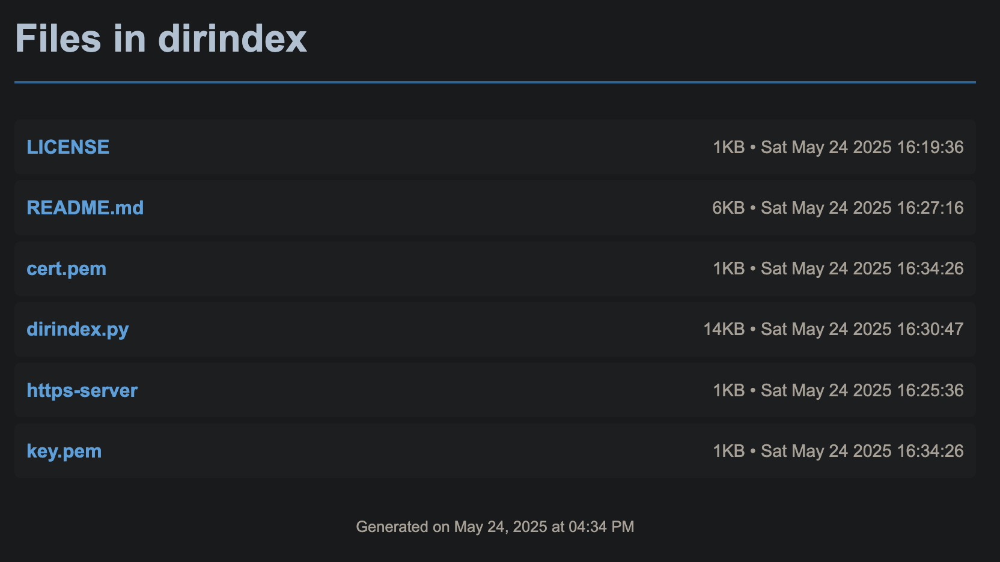

# dirindex

A lightweight directory indexing tool that generates beautiful HTML index pages for file directories, with an optional HTTPS server for secure local file serving.

## Overview

dirindex consists of two complementary tools:

- **`dirindex.py`** - A Python script that generates clean, responsive HTML index pages for directories
- **`https-server`** - A bash script that serves files over HTTPS using a temporary self-signed certificate

Together, these tools provide a quick way to create and serve file listings for development, testing, or local file sharing.

## Features

### dirindex.py Features
- **Flexible file filtering** with glob patterns
- **Multiple sorting options** (name, size, time) with natural numeric sorting
- **Two layout modes**: flex layout or columnar table layout
- **Responsive design** that works on desktop and mobile
- **File metadata display** including size and modification time
- **Clean HTML output** with embedded CSS
- **Automatic exclusion** of the generated index file

### HTTPS-Server Features
- **One-command HTTPS server** using OpenSSL
- **Automatic SSL certificate generation** (self-signed)
- **Clean shutdown** with automatic certificate cleanup
- **Network discovery** showing curl commands for file access
- **Secure file serving** on port 4443

## Example



## Installation

### Prerequisites

**For dirindex.py:**
- Python 3.12 or higher

**For https-server:**
- OpenSSL (usually pre-installed on macOS/Linux)
- `nics` tool for network interface discovery:
  ```bash
  brew tap jftuga/homebrew-tap
  brew update
  brew install jftuga/tap/nics
  ```

### Setup

1. Clone or download the repository
2. Make the scripts executable:
   ```bash
   chmod +x dirindex.py https-server
   ```
3. Optionally, add the directory to your PATH for global access

## Usage

### Basic Directory Indexing

Generate an index of all files in the current directory:
```bash
./dirindex.py
```

Index a specific directory:
```bash
./dirindex.py -i /path/to/files
```

### File Filtering

Index only specific file types using glob patterns:
```bash
# Only HTML and CSS files
./dirindex.py -g "*.html" -g "*.css"

# Only PDF files
./dirindex.py -g "*.pdf"

# Multiple patterns
./dirindex.py -g "*.jpg" -g "*.png" -g "*.gif"
```

### Sorting Options

```bash
# Sort by modification time (newest first)
./dirindex.py --sort-by-time

# Sort by modification time (oldest first)
./dirindex.py --sort-by-time-desc

# Sort by file size (largest first)
./dirindex.py --sort-by-size

# Sort by file size (smallest first)
./dirindex.py --sort-by-size-desc

# Default: natural name sorting (file1.txt, file2.txt, file10.txt)
```

### Layout Options

```bash
# Use columnar table layout
./dirindex.py -c

# Combine with other options
./dirindex.py -c --sort-by-size -g "*.pdf"
```

### Customization

```bash
# Custom title and output filename
./dirindex.py -t "My Files" -o files.html

# Custom header text
./dirindex.py -H "Project Documents"

# Full example
./dirindex.py -i ~/Documents -t "My Documents" -H "Personal Files" -o docs.html -c --sort-by-time
```

### HTTPS Server

Start a secure file server in the current directory:
```bash
./https-server
```

This will:
1. Generate a temporary self-signed SSL certificate
2. Start an HTTPS server on port 4443
3. Display curl commands for downloading files
4. Automatically clean up certificates when stopped (Ctrl-C)

Access the server at: `https://localhost:4443`

**Note:** Your browser will show a security warning due to the self-signed certificate. This is normal for local development.

## Workflow Examples

### Create and Serve a Project Index

```bash
# 1. Generate an index of all source files
./dirindex.py -g "*.py" -g "*.js" -g "*.html" -c --sort-by-time -t "Project Files"

# 2. Start HTTPS server
./https-server

# 3. Access at https://localhost:4443
```

### Document Archive

```bash
# Create a professional-looking index of documents
./dirindex.py -i ~/Documents/Archive -g "*.pdf" -g "*.docx" -c --sort-by-size -t "Document Archive" -H "Company Documents" -o archive.html
```

### Media Gallery Index

```bash
# Create an index of media files
./dirindex.py -g "*.jpg" -g "*.png" -g "*.mp4" --sort-by-time -t "Media Gallery"
```

## Command-Line Reference

### dirindex.py Options

| Option | Short | Description |
|--------|-------|-------------|
| `--input-dir` | `-i` | Input directory to scan (default: current directory) |
| `--title` | `-t` | Set the HTML page title (default: "Directory Index") |
| `--header` | `-H` | Set the header text (default: "Files in [directory name]") |
| `--output` | `-o` | Set output filename (default: "index.html") |
| `--glob` | `-g` | Glob pattern to match files (can be used multiple times) |
| `--columns` | `-c` | Use columnar table layout instead of flex layout |
| `--sort-by-time` | | Sort by modification time, newest first |
| `--sort-by-time-desc` | | Sort by modification time, oldest first |
| `--sort-by-size` | | Sort by file size, largest first |
| `--sort-by-size-desc` | | Sort by file size, smallest first |
| `--version` | `-V` | Show version number and exit |

## Technical Details

### File Size Formatting
- Files under 1KB: displayed in bytes (e.g., "847B")
- Files under 1MB: displayed in kilobytes (e.g., "32KB")
- Files 1MB and larger: displayed in megabytes (e.g., "1MB")

### Natural Numeric Sorting
The tool uses natural sorting for filenames, so `file10.txt` comes after `file2.txt` instead of before it (which would happen with standard alphabetical sorting).

### Security Considerations
- The HTTPS server generates temporary self-signed certificates
- Certificates are automatically cleaned up when the server stops
- **This is intended for local development and testing only**
- Do not use in production environments

## Troubleshooting

### Common Issues

**"No files found" error:**
- Check that the directory exists and contains files
- Verify your glob patterns match existing files
- Use `-g "*"` to match all files if unsure

**HTTPS server won't start:**
- Ensure port 4443 is not already in use
- Check that OpenSSL is installed: `openssl version`
- Verify `nics` is installed for IP address detection

**Permission errors:**
- Make sure scripts are executable: `chmod +x dirindex.py https-server`
- Check directory permissions for both reading source files and writing the index

## DISCLAIMER

The `dirindex.py` script was generated with AI assistance but has been thoroughly tested by hand to ensure proper functionality, security, and adherence to best practices. The `https-server` script was written manually.